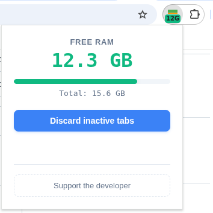
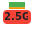

# RAM Light

A lightweight, real-time **Free RAM** monitor for Google Chrome and Chromium-based browsers. 

Shows **how much free memory you have left**, directly in your toolbar.

---

## Screenshots

  
  
  
   
  <em>Left: Normal state badge &nbsp;|&nbsp; Center: Detailed popup view &nbsp;|&nbsp; Right: Low memory warning</em>

---

## Features

- **Smart Toolbar Badge**: Displays free RAM directly on the extension icon with intelligent formatting (e.g., `512M`, `1.2G`, `15G`).
- **Color-Coded Alerts**: The badge background changes dynamically based on free memory percentage:
  - **Green**: > 50% free (Plenty of memory)
  - **Orange**: 20% – 50% free (Moderate load)
  - **Red**: < 20% free (Critically low)
- **One-Click Tab Discard**: Free up memory instantly by discarding inactive tabs. Tabs are safely suspended (not closed) and reload when clicked.
- **Detailed Popup**: Click the icon to see a real-time progress bar, exact free memory, and total system RAM.
- **Battery Efficient**: Built with Manifest V3 Service Workers and Chrome Alarms API. Updates every minute in the background to minimize battery drain, and every 2 seconds only when the popup is open.
- **Privacy-First**: Requires minimal permissions (`system.memory`, `tabs`, `alarms`). Does not request access to your browsing history or any websites.

## Privacy Policy
- RAM Light does NOT collect, store, process, or transmit any personal data, browsing history, or user information. All operations are performed entirely locally on your device.

Look policy details [here](docs/POLICY)

---

## [MIT LICENSE](docs/LICENSE)
