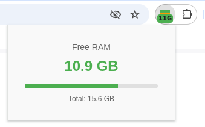

# RAM Light

A lightweight, real-time **Free RAM** monitor for Google Chrome and Chromium-based browsers. 

Shows **how much free memory you have left**, directly in your toolbar.

---

## Screenshots

  
  
  
   
  <em>Left: Normal state badge &nbsp;|&nbsp; Center: Detailed popup view &nbsp;|&nbsp; Right: Low memory warning</em>

---

## Features

- **Smart Toolbar Badge**: Displays free RAM directly on the extension icon with intelligent formatting (e.g., `512M`, `1.2G`, `15G`).
- **Color-Coded Alerts**: The badge background changes dynamically based on free memory percentage:
  - **Green**: > 50% free (Plenty of memory)
  - **Orange**: 20% – 50% free (Moderate load)
  - **Red**: < 20% free (Critically low)
- **Detailed Popup**: Click the icon to see a real-time progress bar, exact free memory, and total system RAM.
- **Resource Efficient**: Built with Manifest V3 Service Workers. Updates every 5 seconds in the background and every 2 seconds only when the popup is open.
- **Privacy-First**: Requires **only** the `system.memory` permission. It does not request access to your browsing history, tabs, or any websites.

---
